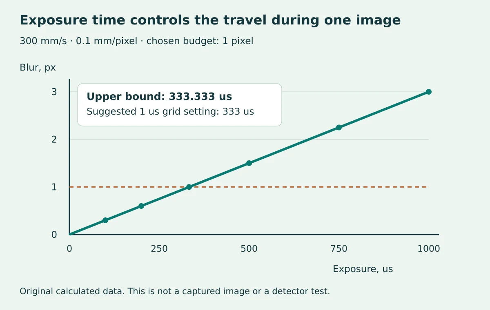

# Camera exposure and motion budget lab

Calculate geometric motion smear, include a bounded acceleration, and check a hypothetical camera's exposure limits and setting increments. Three runnable experiments and thirteen test methods use only Python's standard library. No camera, robot, SDK or pip dependency is needed.

Prepared by William Farokhzad for WIFA Robotics. This offline learning project calculates motion bounds; it does not control or validate a camera. Read the [full camera exposure for motion lesson](https://wifarobotics.com/learn/camera-exposure-for-motion/) on WIFA Robotics for the derivation, worked examples and engineering context.



## Start from zero

Install Python 3.11 or newer from https://www.python.org/downloads/ and check current version support at https://devguide.python.org/versions/. The executed environment was Python 3.12.14 on Linux. Extract the project, open a terminal in the directory containing `main.py`, and run:

```bash
python3 --version
python3 main.py examples/conveyor.json
python3 main.py examples/accelerating.json
python3 main.py examples/device-limit.json
python3 -m unittest discover -s tests -v
```

On Windows PowerShell use `py -3` in place of `python3`, for example `py -3 main.py examples/conveyor.json`. Windows instructions are provided but were not executed. No installation or package command is necessary after Python itself is available.

## Expected results

| Example | Blur bound, px | Motion limit, us | Suggested setting, us | Feasible |
| --- | --- | --- | --- | --- |
| conveyor.json | 3 | 333.333333 | 333 | true |
| accelerating.json | 1.6 | 3162.277660 | 3160 | true |
| device-limit.json | 1.2 | 50 | null | false |

The first two requested exposures fail their motion check; the recommendation is a different shorter setting. The third has no feasible setting at all. See `verified-results.json` for actual complete outputs. Floating-point last digits may differ slightly between environments.

## Read the input contract

All fields are required. Unknown fields are rejected to expose configuration typos.

| Field | Meaning |
| --- | --- |
| speed_mm_s | Nonnegative initial relative speed magnitude at the inspection plane |
| acceleration_bound_mm_s2 | Nonnegative bound on acceleration magnitude during exposure |
| scale_mm_per_px | Positive local millimeters represented by one image pixel |
| blur_limit_px | Positive chosen geometric smear tolerance, not measured detector accuracy |
| exposure_us | Positive requested exposure in microseconds |
| frame_rate_hz | Positive assumed image frequency |
| overhead_us | Nonnegative assumed overhead for a non-overlapping cycle |
| device_min_us | Positive hypothetical minimum exposure |
| device_max_us | Maximum exposure, at least the minimum |
| device_step_us | Positive increment anchored at device_min_us |

The displacement bound is `v*t + a*t*t/2`; divide by mm/pixel for pixel smear. The recommendation rounds down to the setting grid after intersecting the motion bound, device maximum and assumed frame budget. It never rounds up to rescue an impossible case. `motion_limit_us=null` means a stationary model has no motion-imposed bound. `recommended_grid_exposure_us=null` means no setting fits the combined constraints.

The CLI prints one JSON result to stdout. Invalid JSON, fields, bounds or unreadable files produce a useful stderr error and exit 2 with no success JSON. Valid but infeasible configurations exit 0: inspect the result, not just the process return code.

## Tests and experiments

The thirteen tests cover independent worked values, acceleration from rest, infeasibility, zero motion, timing failure, nonzero grid anchors, unit sensitivity, 300 seeded 50-digit Decimal/bisection comparisons, input validation and subprocess examples. Run them from a clean project directory before changing a formula.

Copy the first example and change the exposure to 333 us: the bound becomes 0.999 px and all requested-setting checks pass. At 334 us the motion check fails. Double the speed and calculate the new limit by hand. In a disposable copy remove acceleration from `displacement`; the acceleration test should fail. Restore the source and rerun the tests.

`images/` retains original editable SVG sources and optimized WebP figures at 1200 and 600 pixels. They show calculated data, not captured images or hardware measurements. The complete authored lesson belongs on the WIFA Robotics website. This repository contains the runnable experiments and setup instructions.

## Troubleshooting and limits

Run from the directory containing `main.py`. If Python is missing, finish the official installation and reopen your terminal. Use numbers, not quoted strings or Boolean values. Check millimeters, seconds and microseconds. A scale measured before image resizing may be wrong afterward.

This is a one-dimensional planar calculation, not a camera driver, calibration algorithm, rolling-shutter model or detector validation. No real camera, light, frame rate, Windows system or robot was tested. The timing budget assumes no overlap; real sensors can have different readout/overlap and trigger constraints. The simple grid is not a vendor specification. A strobe's effective exposure needs a separate ambient-light and synchronization model. Do not use this educational calculation as a safety function.

Primary documentation checked 5 November 2026:

* https://docs.baslerweb.com/optimizing-image-quality
* https://docs.baslerweb.com/electronic-shutter-types
* https://docs.baslerweb.com/exposure-time

No license grant is added by this project. Contact the project owner for reuse terms.
